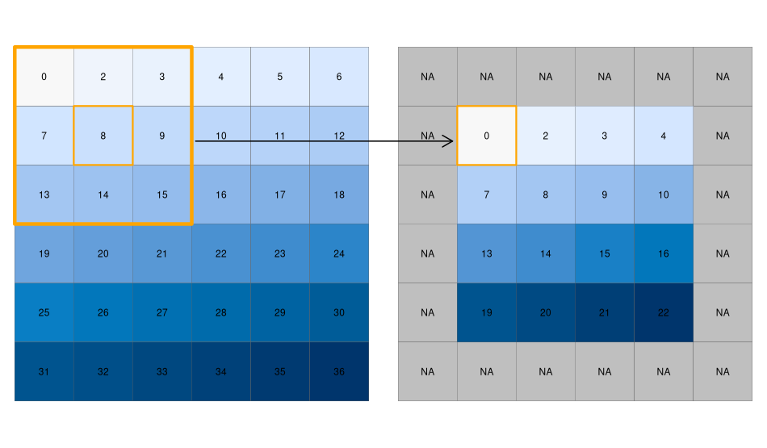

# Raster Operations / Map algebra


## Learning Objectives

By the end of this lesson you will be able to:

- Explain the four sensor **resolution types** and their trade-offs
- Distinguish and apply the four **map algebra operation types** in R
- Understand why **spectral indices** are more robust than raw band values
- Perform **raster–vector operations**: crop, mask, and extract
- Connect **focal operations** to convolutions in image processing


## The Four Resolutions

| Resolution | Definition |
|-----------|-----------|
| **Spatial** | Ground size of one pixel |
| **Temporal** | Revisit frequency |
| **Spectral** | Number & width of bands |
| **Radiometric** | Intensity levels (bit depth) |

**Trade-off example:** Sentinel-2: 10 m · 5 days · 13 bands vs. MODIS: 500 m · daily · 36 bands — higher resolution in one dimension typically comes at the cost of another.

::: {.notes}
For flood mapping you need daily updates → MODIS. For field-level crop mapping you need 10 m pixels → Sentinel-2. Hyperspectral sensors (EnMAP, AVIRIS) trade spatial resolution for hundreds of spectral bands. Radiometric resolution matters for detecting subtle reflectance differences — 16-bit data captures far more detail than 8-bit.
:::


## From Sensor to Analysis: DN vs. Reflectance {.smaller}

- Sensors record **Digital Numbers (DN)**: raw detector output
- DN values depend on illumination angle, atmospheric conditions, and sensor calibration — **not directly comparable** across dates or sensors

**Calibration pipeline:**

| Step | Corrects for |
|------|-------------|
| DN → Radiance | Sensor gain & offset |
| Radiance → TOA Reflectance | Solar illumination angle |
| TOA → Surface Reflectance | Atmospheric scattering & absorption |

Spectral indices are designed to work with reflectance: more **sensor- and date-independent** than raw DN.

::: {.notes}
Sentinel-2 Level-2A = surface reflectance (values scaled ×10000). Level-1C = TOA only. Always check the product level. A common gotcha: computing NDVI on raw Level-2A integers (without dividing by 10000) still gives the right *ratio* because the scale cancels — but it matters when comparing across sensors.
:::


## Introduction

- Map algebra: operations that modify or summarize raster cell values
- Four subclasses, differing in **spatial scope**:
  1. **Local** — per-cell operations
  2. **Focal** — central cell + neighborhood (typically 3×3)
  3. **Zonal** — irregular regions defined by a second raster
  4. **Global** — entire raster(s)

::: {.notes}
The four types differ in spatial scope — how many cells contribute to each output value. Ask students: if I want the mean elevation of each municipality, which type is that? If I want to smooth noise in a satellite image?
:::


```{r}

library(terra)
library(sf)
library(tmap)
library(dplyr)

terraOptions(progress = 0)

r <- rast(system.file("ex/elev.tif", package="terra"))

lux <- system.file("ex/lux.shp", package="terra") |> 
  vect()
zones <- rasterize(lux, r, "NAME_2")
```

```{r}
# make a raster with a boundary around the original values
r_bool <- as.bool(r)

r_bool[!is.na(r)] <- TRUE

r_boundaries <- boundaries(r_bool)

r_boundaries[r_boundaries == 0] <- NA

```


## Operation Types — Illustrated

```{r}
#| label: fig-op-types
#| echo: false
#| fig-height: 2.5
#| fig-cap: "Local (one cell), Focal (3×3 neighborhood), Zonal (coloured regions), Global (entire raster)"

library(ggplot2)
library(patchwork)

tile_plot <- function(m, title) {
  n <- nrow(m)
  df <- expand.grid(x = seq_len(n), y = n:1)
  df$fill <- as.vector(t(m))
  ggplot(df, aes(x, y, fill = fill)) +
    geom_tile(color = "white", linewidth = 0.8) +
    scale_fill_identity() +
    coord_equal() +
    theme_void() +
    labs(title = title) +
    theme(plot.title = element_text(hjust = 0.5, face = "bold", size = 11))
}

w <- "#E8E8E8"; b <- "#4472C4"; d <- "#1F3864"; o <- "#ED7D31"; g <- "#70AD47"

m_local  <- matrix(w, 5, 5); m_local[3, 3] <- b
m_focal  <- matrix(w, 5, 5); m_focal[2:4, 2:4] <- b; m_focal[3, 3] <- d
m_zonal  <- matrix(w, 5, 5); m_zonal[1:2, ] <- o; m_zonal[3:5, 1:3] <- g; m_zonal[3:5, 4:5] <- b
m_global <- matrix(b, 5, 5)

tile_plot(m_local, "Local") + tile_plot(m_focal, "Focal") +
  tile_plot(m_zonal, "Zonal") + tile_plot(m_global, "Global") +
  plot_layout(nrow = 1)
```


## Global Operation (1)

- The most common global operations are descriptive statistics for the entire raster dataset such as the minimum, maximum or mean value.
- For example: What is the mean elevation value for Luxembourg?

::: {.notes}
Common mistake: `mean(r)` computes a per-cell mean across bands (a local operation), not a raster-wide mean. `global()` is the correct function for whole-raster statistics.
:::


```{r}
#| label: fig-elev
#| fig-cap: Elevation of Luxembourg


p0 <- tm_shape(r) + 
    tm_raster(style = "cont", palette = "viridis",legend.show = FALSE) +
    tm_layout(frame = FALSE,legend.outside = TRUE)

p0


p <- tm_shape(r) + 
    tm_raster(alpha = 0, legend.show = FALSE) +
    tm_layout(frame = FALSE,legend.outside = TRUE)

```

```{r}
#| echo: true

# note: mean(r) does not work, since "mean" is used as a local operator
mean_elev <- global(r, mean, na.rm = TRUE)

mean_elev
```


## Global Operation (2)

- Another type of "global" operation is `distance`
- This function calculates the distance from each cell to a specific target cell
- For example, what is the distance from each cell to *Luxembourg City*, the capital of Luxembourg?

```{r}
luxembourg_city <- st_point(c(6.131944,49.611667)) |>
  st_sfc(crs = 4326) |>
  st_sf() |>
  mutate(text = "Luxembourg City")

p0 +
  tm_shape(luxembourg_city) +
  tm_dots(shape = 4, size = 1.4)

luxembourg_city <- vect(luxembourg_city)
```

## Global Operation (2) — Result

```{r}
#| echo: true

r_dist <- distance(r, luxembourg_city)
r_dist <- mask(r_dist, r)
```

```{r}

p0 +
  tm_shape(r_dist) + tm_raster(palette = "magma", style = "cont") +
  tm_shape(st_as_sf(luxembourg_city)) + tm_dots(shape = 4, col = "red") +
  tm_layout(legend.show = FALSE)

```


## Zonal

- Zonal operations apply an aggregation function to multiple raster cells
- A second raster with categorical values define the "zones"

What is the mean altitude *per municipality*?

::: {.notes}
Conceptually this is a spatial group_by + summarize. The zones raster must be integer/categorical — use `rasterize()` to convert vector polygons first. Global is a special case of zonal where the entire raster is a single zone.
:::


```{r}
#| echo: true

mean_vals <- zonal(r, zones, fun = mean, na.rm = TRUE)


```

## Zonal — Result

```{r}
#| label: fig-zonal
#| column: page
#| layout-nrow: 1
#| fig-cap:
#|   - The original Zones (E.g. municipalities of Luxembourg)
#|   - Mean elevation per zone / per municipality


mean_vals2 <- mean_vals |>
  mutate(ID = row_number()-1, .before = 0) |>
  select(-NAME_2)

zones_int <- as.int(zones)

zones_mean <- classify(zones_int, mean_vals2)

p +
  tm_shape(zones, is.master = TRUE) +
  tm_raster(style = "cat",legend.show = TRUE, palette = "Set1")

p +
  tm_shape(zones_mean) +
  tm_raster(style = "cont", palette = "viridis", title = "Mean Elevation")
```

:::{.callout-note collapse="true"}

- The global operation can be seen as a special case of a zonal operation, where the only "Zone" is the entire dataset

:::

## Local (1)

- Local operations comprise all cell-by-cell operations in one or several layers.
- For example, we can classify the elevation into values above and below a certain threshold

::: {.notes}
All arithmetic (+, -, *, /) and logical (>, <, &, |) operators work element-wise on rasters in terra. Boolean rasters are the foundation of masking and multi-condition selection (as in the solar panel example in the tasks).
:::


```{r}
#| echo: true

# first, create a boolean copy of the raster
r_bool <- as.logical(r)

mean_elev <- as.numeric(mean_elev)
mean_elev

r_bool[r > mean_elev] <- FALSE
r_bool[r <= mean_elev] <- TRUE


```

## Local (1)

```{r}

p +
  tm_shape(r_bool) +
  tm_raster(palette = "viridis", title = "Low Elevation")

```


## Local (2)

- This type of (re-) classification is a very common operation
- For more than 2 categories, we can use `classify`


```{r}
#| echo: true
#| output: false
cuts <- global(r, quantile, probs = c(0, .33, .66, 1), na.rm = TRUE)

r_classify <- classify(r, as.numeric(cuts))

# this next line just replaces the default labels with some custom ones
levels(r_classify) <- data.frame(ID = 0:2, category = c("low","mid","high"))
```

## Local (2)

```{r}
p + tm_shape(r_classify) +
    tm_raster(style = "cat",legend.show = TRUE, palette = "viridis", title = "Elevation") +
    tm_layout(legend.show = TRUE)
```


## Local (3) {.smaller}

- Local operations are often used with multiple bands
- For example, we could calculate the mean intensity values of red, green and blue:


```{r}
#| echo: true
l7 <- rast(system.file("tif/L7_ETMs.tif",package = "stars"))

names(l7) <- c("B", "G", "R", "NIR", "SWIR", "MIR")

l7_rgb <- l7[[c("R","G", "B")]]

plot(l7_rgb, nr = 1)

```

## Local (3)

```{r}
#| echo: true
l7_rgb_mean <- mean(l7_rgb)

plot(l7_rgb_mean)
```

## Local (4) {.smaller}

- In a more complex usecase, we could use the R, G and B band to calculate a grayscale value ($L^*$) using the following formula (from [here](https://stackoverflow.com/a/689547/4139249)):

$$\begin{aligned}
\gamma &= 2.2 \\
L^* &= 116 \times Y ^ {\frac{1}{3}} - 16\\
Y &= 0.2126 \times R^\gamma+0.7152 \times G^\gamma+0.0722 \times B^\gamma \\
\end{aligned}
$$


```{r}
#| echo: true
#| output: false

g <- 2.2

l7 <- l7/255 # scale values to 0-1

Y <- 0.2126 * l7[["R"]]^g + 0.7152 * l7[["G"]]^g + 0.0722 * l7[["B"]]^g

L <- 116* Y^(1/3)-16

```

## Local (4)

```{r}

tm_shape(L) + tm_raster(style = "cont", palette = grey.colors(255)) +
  tm_layout(legend.show = FALSE)


```


## Spectral Indices: Why They Work

Healthy vegetation has a characteristic spectral signature:

- **Absorbs red** (~650 nm): chlorophyll uses it for photosynthesis
- **Strongly reflects NIR** (~800 nm): leaf cell structure scatters infrared light

```{r}
#| label: fig-spectral-signature
#| echo: false
#| fig-height: 2.8

library(ggplot2)

wl   <- c(450, 500, 550, 600, 650, 700, 750, 800, 850, 900)
veg  <- c(0.04, 0.05, 0.10, 0.05, 0.04, 0.09, 0.40, 0.47, 0.48, 0.47)
soil <- c(0.07, 0.10, 0.13, 0.16, 0.18, 0.20, 0.22, 0.24, 0.25, 0.26)

df <- data.frame(
  wl   = rep(wl, 2),
  ref  = c(veg, soil),
  type = rep(c("Vegetation", "Bare soil"), each = length(wl))
)

ggplot(df, aes(wl, ref, color = type)) +
  annotate("rect", xmin = 620, xmax = 700, ymin = 0, ymax = 0.55, alpha = 0.12, fill = "red") +
  annotate("rect", xmin = 750, xmax = 900, ymin = 0, ymax = 0.55, alpha = 0.12, fill = "darkred") +
  annotate("text", x = 660, y = 0.52, label = "Red", color = "red3", size = 3.5, fontface = "bold") +
  annotate("text", x = 825, y = 0.52, label = "NIR",  color = "darkred", size = 3.5, fontface = "bold") +
  geom_line(linewidth = 1.4) +
  scale_color_manual(values = c("Vegetation" = "#2d7a4e", "Bare soil" = "#b5854a")) +
  labs(x = "Wavelength (nm)", y = "Reflectance", color = NULL) +
  theme_minimal(base_size = 11) +
  theme(legend.position = "bottom")
```


## Normalized Difference Indices

$$\text{Index} = \frac{A - B}{A + B} \in [-1,\, +1]$$

Normalization reduces the effect of illumination differences.

| Index | Formula | Detects |
|-------|---------|---------|
| **NDVI** | (NIR − Red) / (NIR + Red) | Vegetation density |
| **NDWI** | (Green − NIR) / (Green + NIR) | Open water |
| **NDSI** | (Green − SWIR) / (Green + SWIR) | Snow & ice |
| **NBR** | (NIR − SWIR) / (NIR + SWIR) | Burn severity |

All are **local raster operations** — the same cell-by-cell arithmetic, different band combinations.

::: {.notes}
The normalized difference structure cancels out much of the multiplicative effect of illumination. NDWI has two conflicting definitions — Gao (1996) uses NIR/SWIR, McFeeters (1996) uses Green/NIR. Always check which is cited. The NBR is widely used for post-fire damage assessment with Sentinel-2 or Landsat.
:::


## Focal {#sec-focal-1}

- While local functions operate on one cell focal operations take into account a central (focal) cell *and its neighbors*.
- The neighborhood (also named kernel, filter or moving window) under consideration is typically of size 3-by-3 cells (that is the central cell and its eight surrounding neighbors), but can take on any other size or shape as defined by the user.
- A focal operation applies an aggregation function to all cells within the specified neighborhood, uses the corresponding output as the new value for the central cell, and moves on to the next central cell

::: {.notes}
Key trade-off: larger window → more smoothing but larger NA border (edge effect). `fillNA = TRUE` mitigates this by using whatever neighbors are available at the edges rather than requiring the full window.
:::

:::{#fig-focal}



Note how, depending on the size of your moving window, NA's are produced. Source: @lovelace2019
:::


```{r}
#| echo: true


focal3by3 <- matrix(rep(1,9), ncol = 3)


focal11by11 <- matrix(rep(1,121), ncol = 11)


r_foc3 <- focal(r, focal3by3, fun = mean, fillNA = TRUE)

r_foc11 <- focal(r, focal11by11, fun = mean, fillNA = TRUE)


```


```{r}
#| label: fig-focal2
#| layout-nrow: 1
#| column: page
#| fig-cap: 
#|   - Original values
#|   - Result of a 3x3 Focal Window
#|   - Result of a 11x11 Focal Window


p0 + tm_shape(r_boundaries) + tm_raster() + 
  tm_layout(legend.show = FALSE)

p + tm_shape(r_foc3) + tm_raster(style = "cont", palette = "viridis") +
    tm_layout(legend.show = FALSE, frame = FALSE) +
  tm_shape(r_boundaries) + tm_raster()

p + tm_shape(r_foc11) + tm_raster(style = "cont", palette = "viridis") +
    tm_layout(legend.show = FALSE, frame = FALSE) +
    tm_shape(r_boundaries) + tm_raster()

```

:::{.callout-note collapse="true"}

- Note how the output raster is smaller as the focal window is larger (edge effect)

:::

## Focal weights (1)

- The focal weights we used above were square and evenly weighted

```{r}
#| echo: true
focal3by3
```

```{r}
#| echo: true
#| output: false
focal11by11  # same structure, 11×11
```


## Focal weights (2) {.smaller}

- However, we can also create uneven weights:


For example, a [laplacian filter](https://de.wikipedia.org/wiki/Laplace-Filter) is commonly used for edge detection.

```{r}
#| echo: true


laplacian <- matrix(c(0,1,0,1,-4,1,0,1,0), nrow=3) 

laplacian

```

So are the [sobel filters](https://en.wikipedia.org/wiki/Sobel_operator) — shown on the next slide.

## Focal weights (2) — Sobel {.smaller}

```{r}
#| echo: true

sobel_x <- matrix(c(-1,-2,-1,0,0,0,1,2,1), nrow=3)

sobel_x

sobel_y <- matrix(c(1,0,-1,2,0,-2,1,0,-1), nrow=3)

sobel_y

```


```{r}
#| label: fig-edgedetection
#| fig-cap: 
#|   - Laplacian Filter
#|   - Sobel (x-direction)
#|   - SObel (y-direction)
#| column: page
#| layout-nrow: 1
focal(r, laplacian) |> plot()
focal(r, sobel_x) |> plot()
focal(r, sobel_y) |> plot()

```


## Focal Operations = Convolutions {.smaller}

A focal operation with a weight matrix *is* a **discrete convolution**:

$$(\text{output})_{i,j} = \sum_{m}\sum_{n} w_{m,n} \cdot r_{i+m,\, j+n}$$

This is exactly the operation in **convolutional neural networks (CNNs)**:

| Hand-crafted kernel | Equivalent CNN concept |
|---------------------|----------------------|
| Gaussian blur | Smoothing / anti-aliasing layer |
| Sobel x/y | Edge detection layer |
| Mean filter | Average pooling |

**The key difference**: in deep learning, kernels are *learned from data* rather than designed manually.

::: {.notes}
Worth emphasizing with DS students — a CNN is essentially many stacked focal operations with learned kernels. The Sobel filter they just saw is exactly what a CNN's first conv layer approximates when trained on natural images. The bias-variance tradeoff applies too: larger kernels → more smoothing = more bias, less variance.
:::


## From cells to real world units (1)

- We have been specifying our focal weights in terms of cell units
- In most cases, it is more reasonable to work with real world units
- The resolution of our raster is `0.008333333` (see `res(r)`) and since our raster is in `WGS84`, the units is "degrees". 
- To work with more managable units, we can convert the raster to a projected CRS that uses "meters", e.g. [EPSG 2169](https://epsg.io/2169)


```{r}
res(r)
```

```{r}
#| echo: true
# Reproject to a "projected" CRS
r_2169 <- project(r, "EPSG:2169")
```


## From cells to real world units (2)

- The resolution of our new raster is `r res(r_2169)[1]` meters.
- We can resample this to 1 km to simplify things

```{r}
#| echo: true
res(r_2169)

# first, create template raster with the same extent and 1km resolution
template <- rast(res = 1000, ext = ext(r_2169))

# then, resample to this template
r_2169 <- resample(r_2169, template)
```


## Focal weights with `focalMat`

- `focalMat` creates focal matrices in real-world units (CRS units)
- Shapes: *circle* (`d` = radius), *rectangle* (`d` = dimensions), *Gauss* (`d` = sigma)
- Values sum to 1; matrix size adapts to raster resolution

```{r}
#| warning: false
#| echo: true

focal_circle <- focalMat(x = r_2169, d = 2000, "circle")

focal_circle
```

```{r}
#| fig-cap: Circle filter (2 km radius)
focal_circle |> rast() |> plot()
```

## Focal weights with `focalMat` — Gauss

```{r}
#| echo: true
focal_gauss <- focalMat(x = r_2169, d = 2000, "Gauss")
```

```{r}
#| fig-cap: Gaussian filter (sigma = 2 km)
focal_gauss |> rast() |> plot()
```

## Focal functions in terrain processing

- Focal functions are used to calculate the slope of a specific location, e.g. using the algorithm by @horn1981
- Similarly, calculating the aspect (azimuth) of a location is a very typical task when dealing with elevation data
- These algorithms are used so often, that they are implemented in a dedicated function (`terrain()`)

::: {.notes}
`terrain()` is just a convenience wrapper around a focal operation with a specific kernel. Horn's algorithm uses a 3×3 weighted neighborhood to estimate the gradient in x and y directions, from which slope and aspect are derived.
:::

## Focal functions in terrain processing

```{r}
#| echo: true
#| layout-nrow: 1
#| label: fig-terrain
#| column: page
#| fig-cap:
#|   - Calculating slope using a predefined algorithm
#|   - Calculating aspect


terrain(r, "slope") |> plot()
terrain(r, "aspect") |> plot()
```


## Raster–Vector Operations {.smaller}

Vector data represents discrete geometries: **points**, **lines**, **polygons** — each with a geometry and attributes.

Three fundamental operations linking rasters and vectors:

| Operation | Function | What it does |
|-----------|----------|-------------|
| **Crop** | `crop()` | Reduce raster extent to bounding box of vector |
| **Mask** | `mask()` | Set cells outside vector geometry to NA |
| **Extract** | `extract()` | Get raster cell values at vector locations |

::: {.notes}
`crop()` + `mask()` is almost always used together: crop first (fast — just clips the extent), mask second (precise — removes cells outside the geometry). Extract bridges to tabular analysis — it returns a data frame, not a raster.
:::


## Crop & Mask

```{r}
#| echo: true
#| output: false

one_muni <- lux[5, ]           # one municipality polygon

r_crop <- crop(r, one_muni)
r_mask <- mask(r_crop, one_muni)
```

## Crop & Mask

```{r}
#| label: fig-crop-mask
#| fig-cap:
#|   - Original raster with municipality boundary
#|   - crop() — trims to bounding box
#|   - mask() — outside cells set to NA
#| layout-nrow: 1
#| column: page

plot(r,      main = "Original"); lines(one_muni)
plot(r_crop, main = "crop()")
plot(r_mask, main = "mask()")
```


## Extract {.smaller}

```{r}
#| echo: true

# Sample 20 random point locations
pts <- spatSample(r, 20, as.points = TRUE, na.rm = TRUE)

# Elevation value at each point
extract(r, pts) |> head(5)
```

`extract()` also accepts polygon geometries and an aggregation function:

```{r}
#| echo: true

# Mean elevation per municipality polygon
extract(r, lux, fun = mean, na.rm = TRUE) |> head(3)
```

::: {.notes}
Polygon extract with `fun =` is similar to `zonal()`, but works directly on vector geometry without rasterizing first. For large datasets, the `rasterize()` + `zonal()` approach is usually faster. `extract()` without `fun =` returns every cell value per polygon — useful for building training datasets for classification.
:::


## Summary

| Type | Scope | Key functions |
|------|-------|---------------|
| **Global** | Entire raster | `global()`, `distance()` |
| **Zonal** | Defined regions | `zonal()`, `rasterize()` |
| **Local** | Per cell | `classify()`, `>`, `&`, spectral indices |
| **Focal** | Moving window | `focal()`, `focalMat()`, `terrain()` |
| **Vector ops** | Geometry-based | `crop()`, `mask()`, `extract()` |

