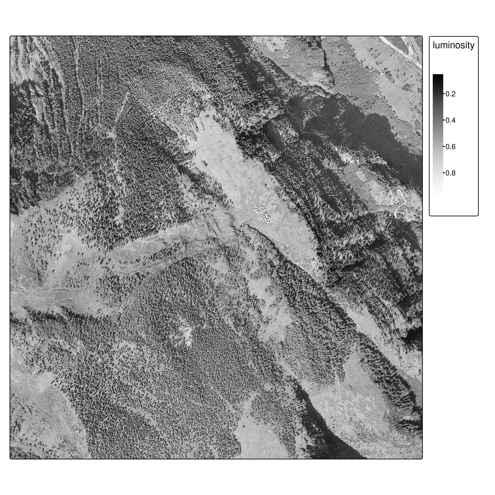
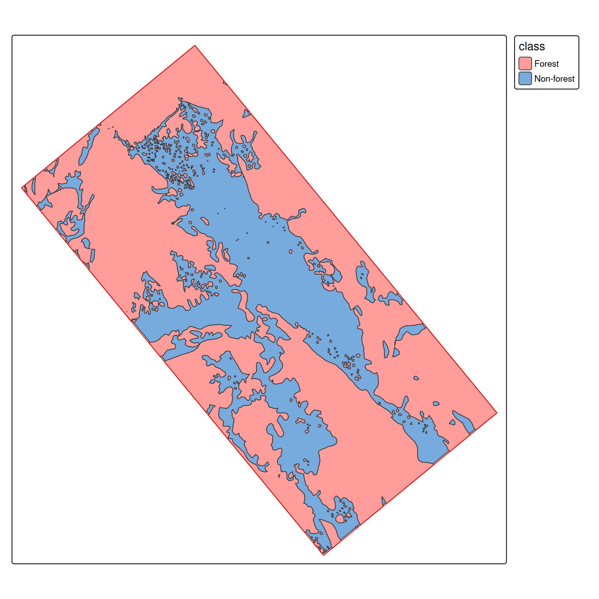
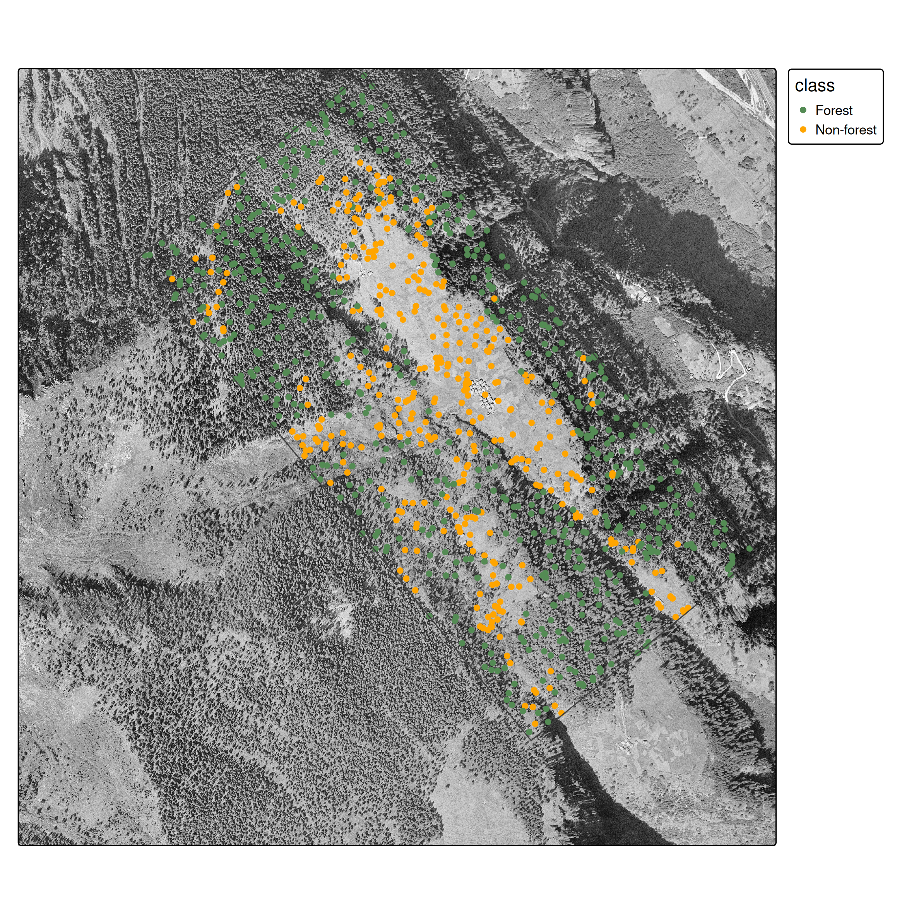
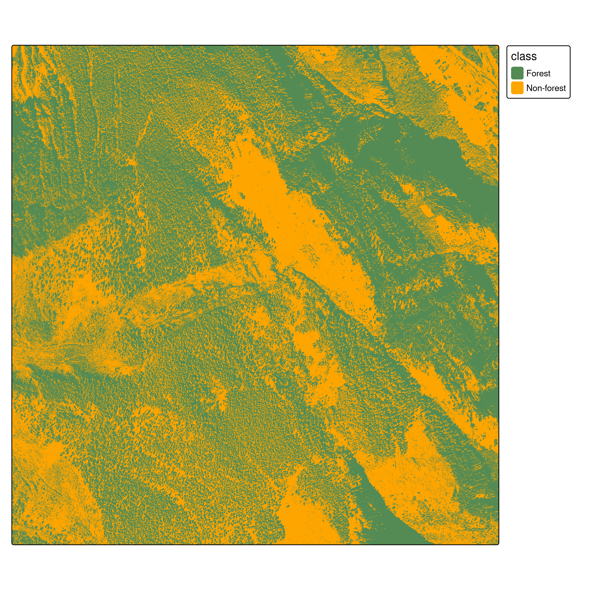
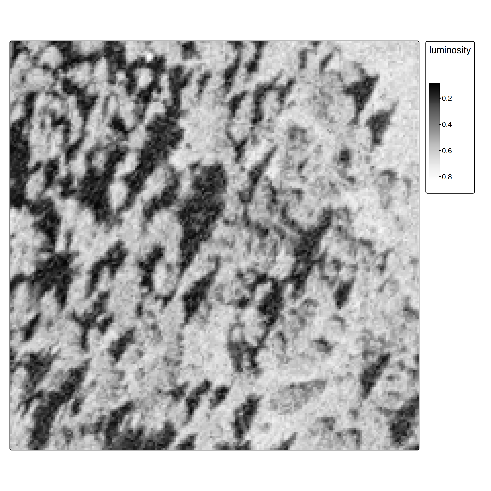
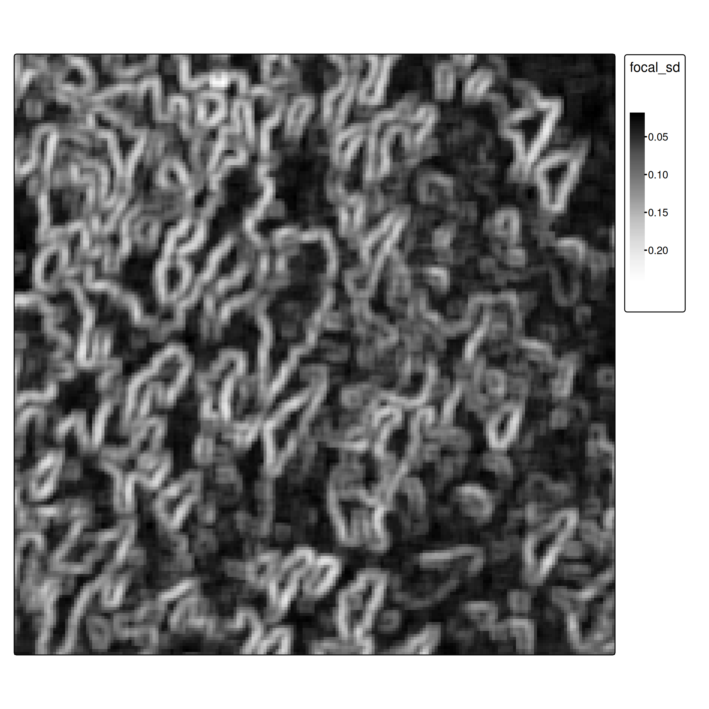

---
execute:
  echo: true
  eval: false
always_allow_html: yes
---

# Supervised Classification in Remote Sensing

## Introduction

- This lesson demonstrates supervised classification applied to remote sensing imagery
- We'll classify historic aerial imagery from 1961 to distinguish forest from non-forest areas in Ces, Ticino, Switzerland
- **Key focus**: The spatial data workflow using terra/sf, not basic ML concepts

---

### What makes RS classification different?

- **Spatial structure**: Pixels are not independent - spatial autocorrelation matters
- **Scale of prediction**: We predict on entire rasters (millions of pixels), not just point datasets
- **Spatial sampling**: Ground truth comes from polygons, requiring careful sampling strategies
- **Feature engineering**: Spatial context (focal operations) is critical, not just pixel values

---

### Data

- Historic aerial imagery from 1961 ([swisstopo](https://map.geo.admin.ch/#/map?lang=de&center=2706292.97,1144053.16&z=9.82&bgLayer=ch.swisstopo.pixelkarte-farbe&topic=ech&layers=ch.swisstopo.swissimage-product_1946,f;ch.swisstopo.swissimage-product@year=1961))
  - Single band (grayscale), 0.5 m/pixel resolution
  - Images available for: 1961, 1971, 1977, 1983, 1989, 1995
- Ground truth forest polygons (hand-digitized)

---




## Workflow Overview


1. Load spatial ground truth (polygons) and generate point samples
2. Spatial train/test split (acknowledging autocorrelation issues)
3. Extract raster features at point locations using `terra::extract()`
4. Train classifier (CART for interpretability)
5. **Predict on entire raster**
6. Evaluate and compare approaches

## Ground Truth & Spatial Sampling

---

### From polygons to points {#sec-spatial-sampling}

Unlike standard ML datasets, our ground truth comes as **spatial polygons**. 


:::{layout-ncol=2}




:::

---

We need point samples for training:

```{r}
# Load polygons
library(sf)
ces_polygons <- read_sf("data/ces_polygons.gpkg", "ces_polygons")
study_area <- read_sf("data/ces_polygons.gpkg", "study_area")

# Generate spatially distributed samples
sample_points <- st_sample(ces_polygons, 1000) |>
  st_sf()
 
# extract class per sample
labelled_data <- st_join(sample_points, ces_polygons) |>
  select(-jahr)

labelled_data$class <- factor(labelled_data$class)
```

---



---

**`st_sample()`**

- Ensures spatial coverage across polygon extents
- Creates balanced datasets
- Simple random sampling across the entire study region (more sophisticated strategies exist)

---


### Train/test split: The spatial autocorrelation problem

:::{.callout-important}
**Spatial autocorrelation issue**: Random splits violate independence assumptions because nearby pixels are correlated. Proper approaches use spatial cross-validation [@brenning2023; @schratz2021]. We use random splits here for simplicity, but be aware this may overestimate performance.
:::


## Approach 1: Single-Band Classification

Feature extraction with `terra::extract()`

```{r}

train_features <- terra::extract(ces1961, data_train, ID = FALSE)

data_train2 <- cbind(data_train[,"class"], train_features) |>
  st_drop_geometry()

data_train2
```

---

```{r}
#| eval: true
#| echo: false
# Extract pixel values at training points

load("data/data_train.Rda")

data_train2

```


---

### Training

We use CART (decision trees) for interpretability. As experienced ML practitioners, feel free to substitute with Random Forest, XGBoost, etc.

```{r}
library(rpart)
cart_model <- rpart(class~luminosity, data = data_train2)
```

---

```{r}
#| label: fig-cart-basic
#| fig-cap: Decision tree for single-band classification
#| echo: false
#| eval: true

load("data/cart_model.Rda")


library(rpart.plot)
rpart.plot(cart_model)
```

---

### Raster prediction


```{r}
# Predict probability per class for all pixels
ces1961_predict <- predict(ces1961, cart_model)

# Get highest probability class
ces1961_predict2 <- which.max(ces1961_predict)

# Assign class labels
classes <- levels(data_train2$class)
classes_df <- data.frame(ID = seq_along(classes), class = classes)
levels(ces1961_predict2) <- classes_df
```

---



---

### Evaluation


```{r}
#| echo: false
#| eval: true
#| label: tbl-confusion-matrix-basic
#| tbl-cap: Confusion matrix for single-band classification

library(tidyr)
library(kableExtra)

load("data/confusion_matrix.Rda")

confusion_matrix2 <- confusion_matrix |>
  as_tibble() |>
  pivot_wider(names_from = actual, values_from = n, values_fill = 0)

highlight_diagonal <- \(kable_table, diag_cols, color = "red", default_color = "white") {
  purrr::reduce(seq_along(diag_cols), \(tbl, i) {
    tbl |> column_spec(diag_cols[i], background = ifelse(seq_along(diag_cols) == i, color, default_color))
  }, .init = kable_table)
}

col_names <- colnames(confusion_matrix2)
col_names[1] <- ""

kable(confusion_matrix2, col.names = col_names) |>
  kable_styling(full_width = FALSE) |>
  column_spec(1, bold = TRUE) |>
  highlight_diagonal(2:3) |>
  add_header_above(c(" " = 1, "Actual" = 2))
```

```{r}
#| echo: false
#| eval: true
confusion_matrix3 <- as.matrix(confusion_matrix2[,-1])
correct <- diag(confusion_matrix3)
tot <- colSums(confusion_matrix3)
acc_basic <- sum(correct)/sum(tot)
acc_basic_str <- format(acc_basic, digits = 2)
```

**Overall accuracy**: `r acc_basic_str`


## The Spatial Context Problem {#sec-spatial-context}

### Why single pixels fail


{#fig-zoom-problem}

---

**Key insight**: Humans use spatial context (texture, patterns, neighbors) to classify land cover. Our model currently uses only single pixel values - it's "blind" to spatial structure.


## Approach 2: Adding Spatial Features {#sec-feature-engineering}

### Focal operations as feature extractors

**Focal operations** aggregate neighborhood values, providing spatial context:

```{r}
# Define 5x5 neighborhood
n <- 5
focal_window <- matrix(rep(1, n^2), ncol = n)

# Calculate standard deviation in each neighborhood
ces1961_focal_sd <- focal(ces1961, focal_window, fun = sd, fillvalue = 0)
```

---

:::{#fig-zoom-comparison layout-ncol=2}



:::


---

### Normalization for multi-feature learning

When combining features, normalize to [0,1] using min-max scaling:

$$x' = \frac{x - \min(x)}{\max(x) - \min(x)}$$

```{r}
minmax_normalization <- function(x){
  minmax_vals <- minmax(x)[,1]
  (x - minmax_vals[1]) / (minmax_vals[2] - minmax_vals[1])
}

ces1961_focal_sd <- minmax_normalization(ces1961_focal_sd)

# Combine original and focal features
ces_multi <- c(ces1961, ces1961_focal_sd)
names(ces_multi) <- c("luminosity", "focal_sd")
```

---

### Training with spatial features

```{r}
# Extract both features
train_features_multi <- terra::extract(ces_multi, data_train, ID = FALSE)
data_train2_multi <- cbind(data_train, train_features_multi) |>
  st_drop_geometry() |> 
  select(-area)

# Train model
cart_model_multi <- rpart(class~., data = data_train2_multi)
```

---

```{r}
#| label: fig-cart-multi
#| echo: false
#| eval: true
#| fig-cap: Decision tree now uses both luminosity and spatial texture

load("data/cart_model_multi.Rda")

rpart.plot(cart_model_multi, type = 3)
```

---

### Prediction and evaluation


```{r}
#| echo: false
#| eval: true
#| label: tbl-confusion-matrix-multi
#| tbl-cap: Confusion matrix with spatial features

load("data/vals.Rda")

col_names_multi <- colnames(confusion_matrix2_multi)
col_names_multi[1] <- ""

kable(confusion_matrix2_multi, col.names = col_names_multi) |>
  kable_styling(full_width = FALSE) |>
  column_spec(1, bold = TRUE) |>
  highlight_diagonal(2:3) |>
  add_header_above(c(" " = 1, "Actual" = 2))
```

**Overall accuracy**: `r acc_multi_str` (vs. `r acc_basic_str` without spatial features)


---

### Further improvements

For advanced applications, consider:

- **More focal features**: mean, variance, edge detection filters
- **Multi-scale features**: focal operations at different window sizes
- **Deep learning**: CNNs naturally capture spatial context
- **Object-based classification**: segment first, then classify
- **Proper spatial CV**: Use spatial blocking for more realistic evaluation


<!--

## Temporal Analysis {#sec-temporal-analysis}

A key RS capability: applying models across time series.

### Loading multiple years

```{r}
years <- c(1961, 1971, 1977, 1983, 1989, 1995)

ces_all <- lapply(years, \(year) {
  r <- rast(paste0("data-large/ces/", year, ".tif"))
  r <- r / 255
  names(r) <- "luminosity"
  return(r)
})

names(ces_all) <- years
```

---

### Applying the model across time

```{r}
# Apply focal operation to all years
ces_all_focal <- lapply(ces_all, \(raster) {
  focal_sd <- focal(raster, focal_window, fun = sd, fillvalue = 0)
  focal_sd <- minmax_normalization(focal_sd)
  multi <- c(raster, focal_sd)
  names(multi) <- c("luminosity", "focal_sd")
  return(multi)
})

# Predict for all years
predictions_all <- lapply(ces_all_focal, \(raster) {
  pred_prob <- predict(raster, cart_model_multi)
  pred_class <- which.max(pred_prob)
  levels(pred_class) <- classes_df
  return(pred_class)
})

names(predictions_all) <- years
```

---

### Visualizing change over time

```{r}
#| fig-width: 12
#| fig-height: 8
#| fig-cap: Forest classification across time (model trained on 1961 applied to all years)

library(patchwork)

plot_comparison <- function(year) {
  p1 <- tm_shape(ces_all[[as.character(year)]]) +
    tm_raster(palette = "-Greys", legend.show = FALSE) +
    tm_layout(main.title = paste(year, "- Original"),
              main.title.size = 1.2,
              main.title.position = "center")

  p2 <- tm_shape(predictions_all[[as.character(year)]]) +
    tm_raster(palette = c("Forest" = "palegreen4", "Non-forest" = "orange"),
              title = "Class") +
    tm_layout(main.title = paste(year, "- Classification"),
              main.title.size = 1.2,
              main.title.position = "center",
              legend.outside = TRUE)

  return(tmap_arrange(p1, p2, ncol = 2))
}

tmap_mode("plot")

for (year in years) {
  print(plot_comparison(year))
}
```

---

### Forest cover trends

```{r}
#| fig-cap: Forest area change (1961-1995)

forest_area <- sapply(predictions_all, \(pred) {
  freq_table <- freq(pred)
  forest_pixels <- freq_table[freq_table$class == "Forest", "count"]
  forest_ha <- forest_pixels / 10000
  return(forest_ha)
})

forest_df <- data.frame(
  year = as.numeric(names(forest_area)),
  forest_ha = as.numeric(forest_area)
)

library(ggplot2)
ggplot(forest_df, aes(x = year, y = forest_ha)) +
  geom_line(color = "palegreen4", linewidth = 1.5) +
  geom_point(color = "palegreen4", size = 3) +
  labs(x = "Year", y = "Forest area (hectares)",
       title = "Forest cover change (1961-1995)") +
  theme_minimal() +
  theme(text = element_text(size = 12))
```


```{r}
#| echo: false

save.image(file = "data-out/workspace.Rdata")
```


-->

## Tasks

### Core exercises

1. Download datasets (*ces_polygons.gpkg* and TIF files for 1961-1995) from Moodle
2. Implement the complete workflow:
   - Load and sample spatial ground truth
   - Train classifier (single band or with additional features)
   - Evaluate with confusion matrix
3. Apply model temporally and analyze forest cover trends


## References {#refs}
