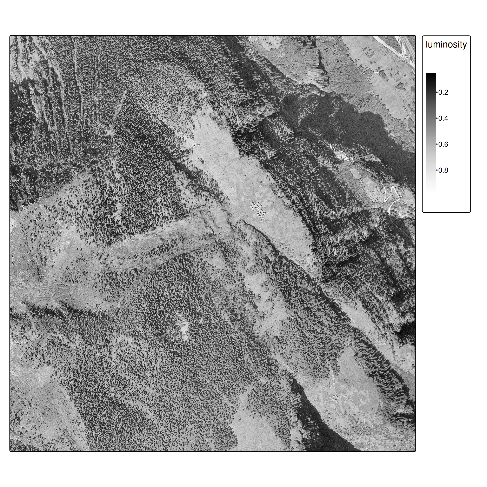
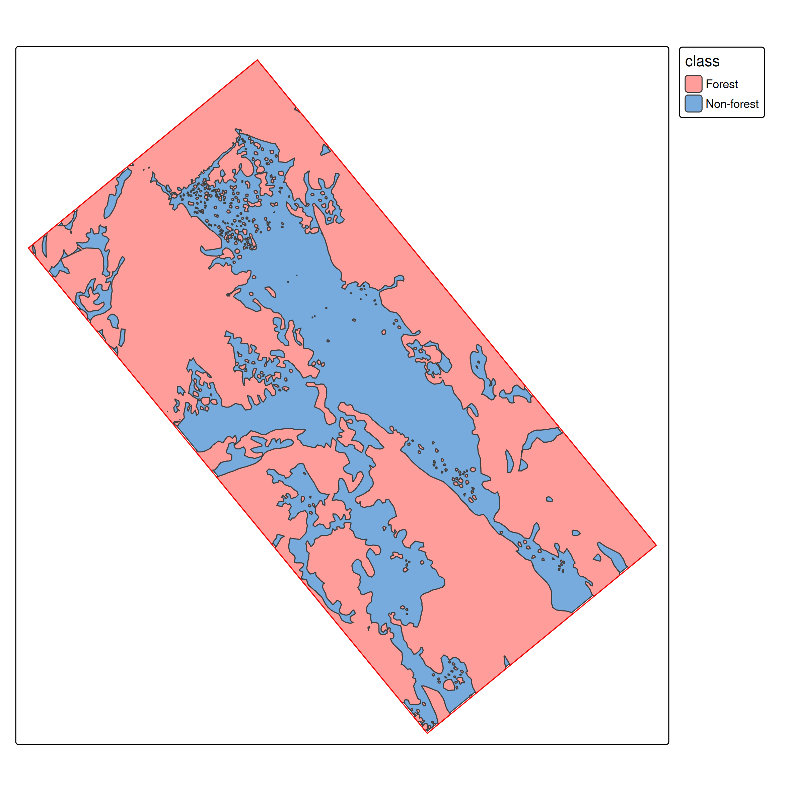
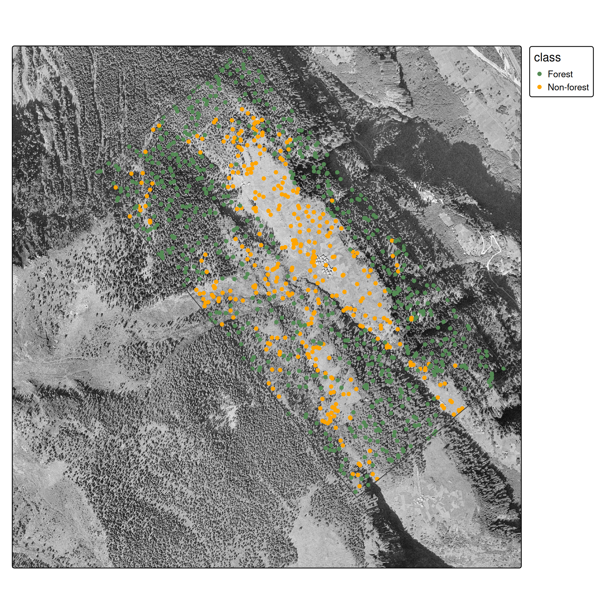
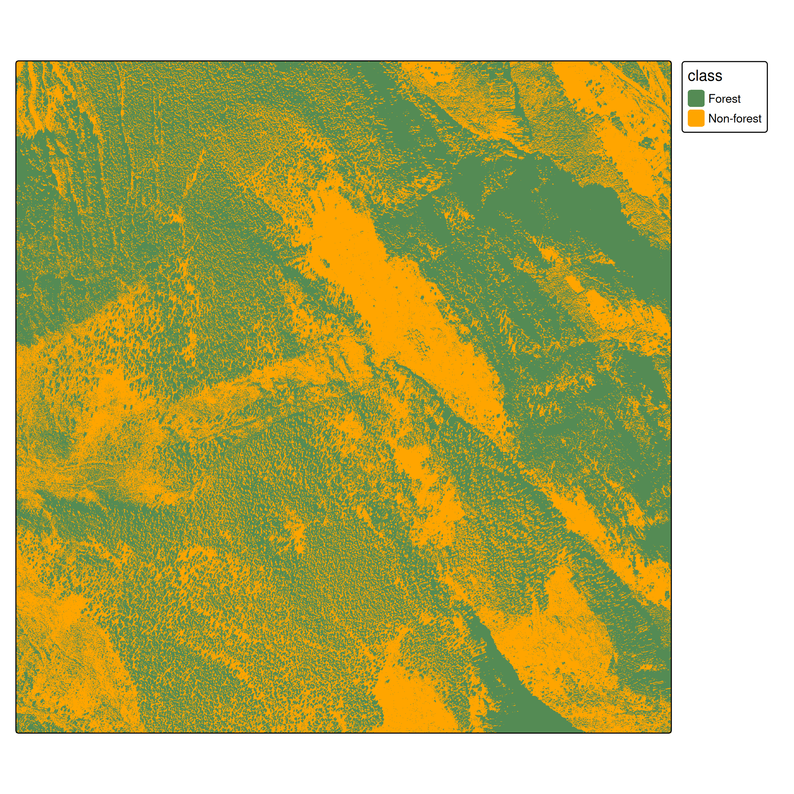
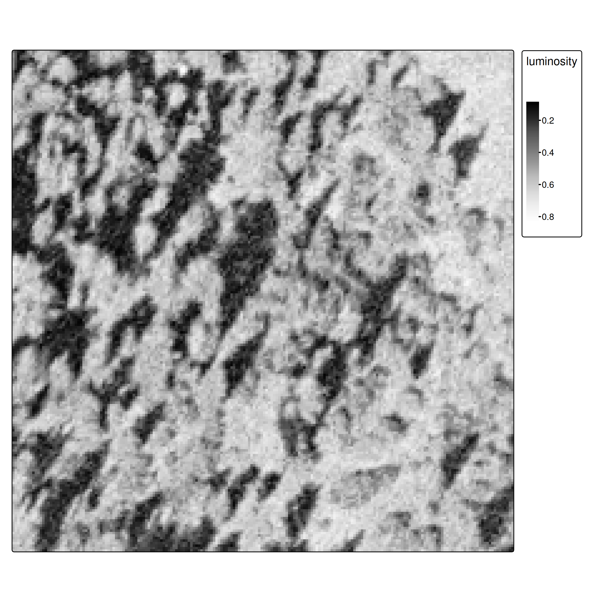
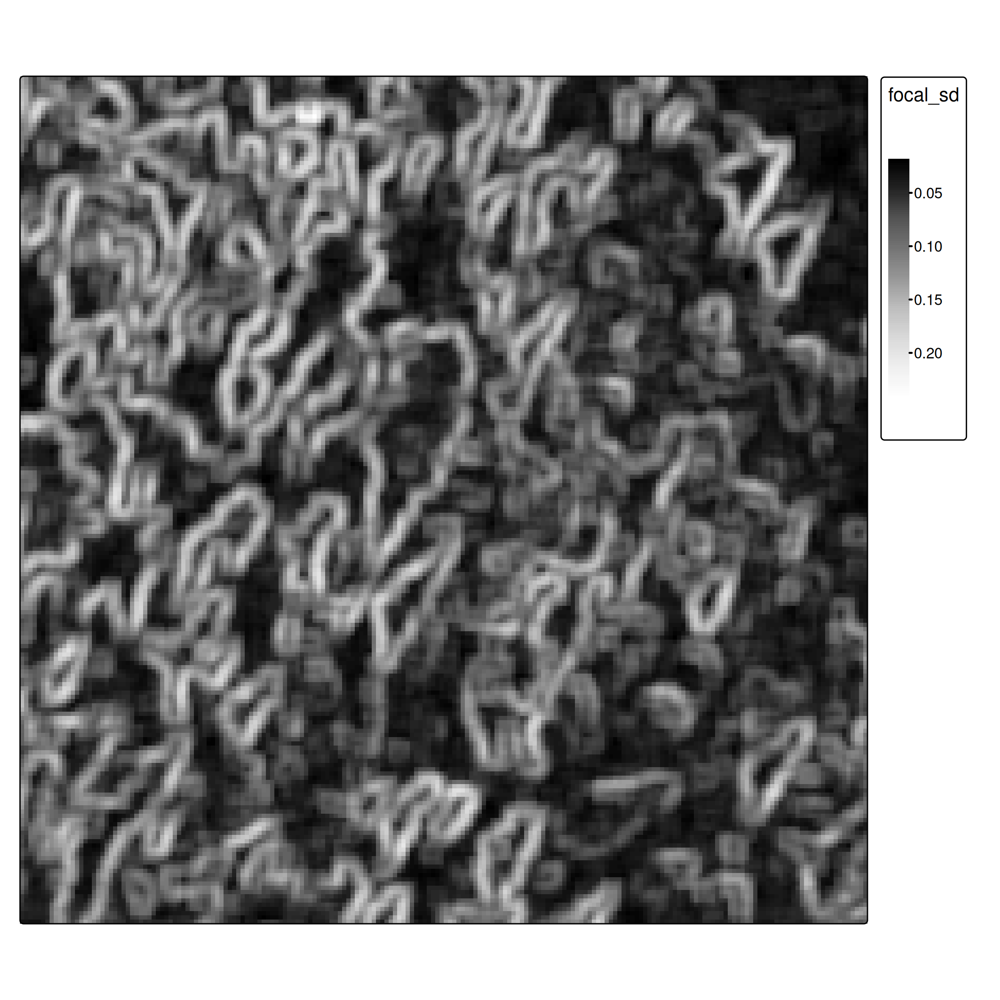

---
format:
  clean-revealjs:
    css: misc/slides.css
    smaller: true
execute:
  echo: true
  eval: false
  cache: true
---

```{r}
#| echo: false
#| cache: false

library(sf)
library(terra)
library(rpart)
library(rpart.plot)
library(tidyr)
library(kableExtra)
library(purrr)
```

# Supervised Classification <br> in Remote Sensing {.r-fit-text .titlepage}

## Learning Objectives {.smaller}

By the end of this lesson you will be able to:

- Describe the **supervised classification pipeline**: from labelled ground truth polygons to a full raster map
- Explain the **polygon-to-point sampling step**: why it is needed in this workflow and what it implies for class balance and spatial autocorrelation
- Explain the **spatial autocorrelation problem** and why it makes standard accuracy estimates misleading
- Explain the role of **feature extraction** as the bridge between raster data and any ML algorithm
- Explain why **pixel brightness alone** often fails, and how **spatial texture** addresses this limitation
- Distinguish **overall accuracy, producer's accuracy, and user's accuracy** — and what each tells a map-maker


# Introduction {.subtitle}

## What makes RS classification different?

- **Spatial structure**: pixels are not independent — spatial autocorrelation matters
- **Scale of prediction**: we predict on entire rasters (millions of pixels), not just point datasets
- **Spatial sampling**: ground truth comes from polygons, requiring careful sampling strategies
- **Feature engineering**: spatial context (focal operations) is critical, not just pixel values

:::{.notes}
These differences are why we can't just apply generic ML tutorials to RS data!

The spatial workflow (`terra`/`sf` packages) and understanding spatial autocorrelation are essential skills, regardless of whether you use classical ML or deep learning.
:::

---

### Data

- Historic aerial imagery from 1961 ([swisstopo](https://map.geo.admin.ch/#/map?lang=de&center=2706292.97,1144053.16&z=9.82&bgLayer=ch.swisstopo.pixelkarte-farbe&topic=ech&layers=ch.swisstopo.swissimage-product_1946,f;ch.swisstopo.swissimage-product@year=1961))
  - Single band (grayscale), 0.5 m/pixel resolution
  - Images available for: 1961, 1971, 1977, 1983, 1989, 1995
- Ground truth forest polygons (hand-digitized)


## {background-iframe="https://map.geo.admin.ch/#/map?lang=de&center=2706292.97,1144053.16&z=9.82&topic=ech&layers=ch.swisstopo.swissimage-product_1946,f;ch.swisstopo.swissimage-product@year=1961&bgLayer=ch.swisstopo.pixelkarte-farbe" background-interactive=true}

<button onclick="Reveal.next()" style="position:fixed;bottom:1.2rem;right:1.2rem;z-index:9999;padding:.5em 1.2em;font-size:1.1em;background:rgba(0,0,0,.55);color:#fff;border:none;border-radius:6px;cursor:pointer;pointer-events:auto;">→</button>

---




## Workflow Overview


1. Load ground truth polygons and generate point samples
2. Spatial train/test split (⚠ autocorrelation)
3. Extract raster features using `extract()`
4. Train classifier (CART for interpretability)
5. **Predict on entire raster**
6. Evaluate and compare approaches


# Ground Truth & Spatial Sampling {.subtitle}

## From polygons to points {#sec-spatial-sampling}

Unlike standard ML datasets, our ground truth comes as **spatial polygons**.


:::{layout-ncol=2}




:::

---

We need point samples for training:

```{r}
# Load polygons
library(sf)
ces_polygons <- read_sf("data/ces_polygons.gpkg", "ces_polygons")
study_area <- read_sf("data/ces_polygons.gpkg", "study_area")
```

[]{}

```{r}
# Generate spatially distributed samples
sample_points <- st_sample(ces_polygons, 1000) |>
  st_sf()
```

[]{}

```{r}
# Attach class label to each point
labelled_data <- st_join(sample_points, ces_polygons) |>
  select(-jahr)

labelled_data$class <- factor(labelled_data$class)
```

---



---

**`st_sample()`** draws random points *within* each polygon geometry.

**`st_join()`** does a spatial left join — for each point it finds the polygon that contains it and copies over the attributes (`class`, etc.).

Result: an `sf` data frame where every row is a labelled point with known coordinates.

:::{.notes}
`st_join()` is a spatial equivalent of `dplyr::left_join()`. Instead of matching on a key column it matches on spatial containment/intersection.

The `-jahr` drop is just to keep the data frame clean — `jahr` is the digitizing year, not useful as a feature.
:::

---

## Train/test split: The spatial autocorrelation problem

:::{.callout-important}
**Spatial autocorrelation issue**: Random splits violate independence assumptions because nearby pixels are correlated. Proper approaches use spatial cross-validation [@brenning2023; @schratz2021]. We use random splits here for simplicity, but be aware this may overestimate performance.
:::

:::{.notes}
**Pedagogical simplification**: Random train/test split

**Production approach**:
- Spatial k-fold cross-validation with geographic blocking
- Ensures training and test data are spatially separated
- Packages: `sperrorest`, `mlr3spatiotempcv`, `CAST`
- More realistic performance estimates
:::

---

```{r}
set.seed(42)
idx        <- sample(nrow(labelled_data), floor(0.7 * nrow(labelled_data)))
data_train <- labelled_data[ idx, ]
data_test  <- labelled_data[-idx, ]
```

- 70 / 30 split is a common heuristic
- `set.seed()` makes the result reproducible
- Both sets **retain their geometries** — we still know where each point is on the map


# Approach 1: Single-Band Classifier {.subtitle}

## Feature extraction {#sec-feature-extraction1}

`terra::extract()` samples raster values at each point location:

```{r}
train_features <- terra::extract(ces1961, data_train, ID = FALSE)

data_train2 <- cbind(data_train[,"class"], train_features) |>
  st_drop_geometry()
```

:::{.notes}
`ID = FALSE` drops the row index column that terra adds by default.

`st_drop_geometry()` removes the spatial geometry — the ML model doesn't need coordinates, only the feature values.
:::


```{r}
#| eval: true
#| echo: false
load("data/data_train.Rda")

head(data_train2, 10)
```

---

## From spatial to tabular

After feature extraction, the spatial complexity is gone — we have a plain data frame:

| class | luminosity |
|---|---|
| Forest | 0.38 |
| Non-forest | 0.74 |
| Forest | 0.41 |
| … | … |

From here, **any standard ML algorithm applies**. The spatial awareness is only needed again at prediction time, when we apply the model back to the full raster.

---

## Training {#sec-training-model1}

We use CART (decision trees) for interpretability. As experienced ML practitioners, feel free to substitute with Random Forest, XGBoost, etc.

```{r}
library(rpart)
cart_model <- rpart(class ~ luminosity, data = data_train2)
```

:::{.notes}
**Pedagogical choice**: CART for transparency

**Production alternatives**:
- Random Forest / XGBoost: Better accuracy, handles non-linearity
- Support Vector Machines: Good with limited training data
- Neural Networks: Requires more data but state-of-the-art performance

CART lets students see *exactly* what decision boundaries the model learned.
:::

---

```{r}
#| label: fig-cart-basic
#| fig-cap: Decision tree for single-band classification
#| echo: false
#| eval: true

load("data/cart_model.Rda")

library(rpart.plot)
rpart.plot(cart_model)
```

---

## Raster prediction

```{r}
# Predict probability per class for all pixels
ces1961_predict <- predict(ces1961, cart_model, type = "prob")

# Get highest probability class
ces1961_predict2 <- which.max(ces1961_predict)
```

---

## How `terra::predict()` works

Conceptually: iterate over every pixel, build a one-row data frame of its values, call `predict(model, newdata = ...)`, write the result back.

```
for each pixel (i, j):
    features <- extract value(s) at (i, j)
    probs    <- predict(model, newdata = features, type = "prob")
    output[i, j] <- probs
```

- Output of `predict(raster, model, type = "prob")`: one **layer per class**, values = probabilities
- `which.max()` returns an integer raster: which layer has the highest probability?

---

## Setting categorical levels

`which.max()` returns **integers** (1, 2, …). To get meaningful labels:

```{r}
classes_df <- data.frame(id = 1:2, class = levels(data_train2$class))
levels(ces1961_predict2) <- classes_df
```

- The layer order matches the **alphabetical order** of factor levels in the training data
- Without this step the result raster only contains 1s and 2s

---



---

## Evaluation {#sec-model-evaluation-1}

Before showing the numbers: **how to read a confusion matrix**

|  | Actual: Forest | Actual: Non-forest |
|---|:---:|:---:|
| **Predicted: Forest** | TP | FP |
| **Predicted: Non-forest** | FN | TN |

- **Overall accuracy** = (TP + TN) / total
- **Producer's accuracy** (recall) = TP / (TP + FN) — "of actual forest, how much did we catch?"
- **User's accuracy** (precision) = TP / (TP + FP) — "when we predict forest, how often is it right?"

:::{.notes}
Overall accuracy is misleading when classes are imbalanced (e.g. 90% non-forest): a model that always predicts non-forest gets 90% accuracy.

Producer's accuracy matters for the map-maker ("is my map complete?").
User's accuracy matters for the map-user ("can I trust this label?").
:::

---


```{r}
#| echo: false
#| eval: true
#| label: tbl-confusion-matrix-basic
#| tbl-cap: Confusion matrix for single-band classification

library(tidyr)
library(kableExtra)

load("data/confusion_matrix.Rda")

confusion_matrix2 <- confusion_matrix |>
  as_tibble() |>
  pivot_wider(names_from = actual, values_from = n, values_fill = 0)

highlight_diagonal <- \(kable_table, diag_cols, color = "red", default_color = "white") {
  purrr::reduce(seq_along(diag_cols), \(tbl, i) {
    tbl |> column_spec(diag_cols[i], background = ifelse(seq_along(diag_cols) == i, color, default_color))
  }, .init = kable_table)
}

col_names <- colnames(confusion_matrix2)
col_names[1] <- ""

kable(confusion_matrix2, col.names = col_names) |>
  kable_styling(full_width = FALSE) |>
  column_spec(1, bold = TRUE) |>
  highlight_diagonal(2:3) |>
  add_header_above(c(" " = 1, "Actual" = 2))
```

```{r}
#| echo: false
#| eval: true
confusion_matrix3 <- as.matrix(confusion_matrix2[,-1])
correct <- diag(confusion_matrix3)
tot <- colSums(confusion_matrix3)
acc_basic <- sum(correct)/sum(tot)
acc_basic_str <- format(acc_basic, digits = 2)
```

**Overall accuracy**: `r acc_basic_str`


# The Spatial Context Problem {.subtitle}

## Why pixel-based classification struggles {#sec-spatial-context}

- At pixel level, it is hard to distinguish forest from non-forest
- Spatial context is essential: humans use texture, patterns, and neighborhoods to classify land cover

{#fig-zoom-problem}


:::{.notes}
This is the **core limitation** of pixel-based classification.

Modern deep learning (CNNs) solves this automatically by processing image patches, but we'll first show the manual approach to understand *why* spatial context matters.
:::


# Approach 2: Adding Spatial Features {.subtitle}

## Focal operations as feature extractors {#sec-feature-engineering}

**Focal operations** aggregate neighborhood values, providing spatial context:

```{r}
i <- 5
focal_window <- focalMat(ces1961, d = (i-1)/2 * res(ces1961)[1], type = "rectangle")

# Standard deviation within each 5×5 neighborhood
ces1961_focal_sd <- focal(ces1961, focal_window, fun = "sd")
```

- **High SD** → heterogeneous neighborhood → likely a forest edge or textured canopy
- **Low SD** → uniform neighborhood → likely open field or dense uniform forest

:::{.notes}
**Pedagogical approach**: Handcrafted focal features

**Why we do this**:
- Explicit, understandable feature engineering
- Shows *what* spatial context means (texture/variation)
- Works with classical ML algorithms

**Production approach**: Convolutional Neural Networks (CNNs)
- CNNs learn optimal spatial filters automatically during training
- First layer convolution weights = learned focal operations
- Can learn multi-scale features (equivalent to multiple focal window sizes)
- State-of-the-art: U-Net, DeepLabV3+, Vision Transformers
:::


---

:::{#fig-zoom-comparison layout-ncol=2}



:::


---

## Normalization for multi-feature learning

When combining features with different scales, normalize to [0, 1] using min-max scaling:

$$x' = \frac{x - \min(x)}{\max(x) - \min(x)}$$

```{r}
minmax_normalization <- function(x){
  minmax_vals <- minmax(x)[,1]
  (x - minmax_vals[1]) / (minmax_vals[2] - minmax_vals[1])
}

ces1961_focal_sd <- minmax_normalization(ces1961_focal_sd)

# Stack: now a 2-band raster
ces_multi <- c(ces1961, ces1961_focal_sd)
names(ces_multi) <- c("luminosity", "focal_sd")
```

Why normalize? Decision trees are invariant to scale, but other algorithms (SVM, KNN, neural networks) are not. It's good practice regardless.

---

## Training with spatial features

The call is identical — `rpart` just sees more columns now:

```{r}
# Same workflow, but data_train2_multi has two feature columns
cart_model_multi <- rpart(class ~ ., data = data_train2_multi)
```


```{r}
#| label: fig-cart-multi
#| echo: false
#| eval: true
#| fig-cap: Decision tree now uses both luminosity and spatial texture

load("data/cart_model_multi.Rda")

rpart.plot(cart_model_multi, type = 3)
```

---

## Prediction and evaluation {#sec-model-evaluation-2}


```{r}
#| echo: false
#| eval: true
#| label: tbl-confusion-matrix-multi
#| tbl-cap: Confusion matrix with spatial features

load("data/vals.Rda")

col_names_multi <- colnames(confusion_matrix2_multi)
col_names_multi[1] <- ""

kable(confusion_matrix2_multi, col.names = col_names_multi) |>
  kable_styling(full_width = FALSE) |>
  column_spec(1, bold = TRUE) |>
  highlight_diagonal(2:3) |>
  add_header_above(c(" " = 1, "Actual" = 2))
```

**Overall accuracy**: `r acc_multi_str` (vs. `r acc_basic_str` without spatial features)

---

## What did we gain?

| | Features | Overall accuracy |
|---|---|:---:|
| Approach 1 | luminosity | `r acc_basic_str` |
| Approach 2 | luminosity + focal SD | `r acc_multi_str` |

The texture feature captures **local variation** — forest canopy looks rougher at 0.5 m resolution than agricultural fields or roads.

**One extra focal operation nearly free-rides on the existing workflow** — same model, same extraction, same prediction step.

---

## Further improvements

For advanced applications, consider:

- **More focal features**: mean, local range, edge-detection filters (Sobel, Laplacian)
- **Multi-scale features**: focal operations at different window sizes (5×5, 15×15, 31×31)
- **Deep learning**: CNNs learn optimal spatial filters automatically — no manual feature engineering
- **Object-based classification**: segment the image first, then classify segments rather than pixels
- **Proper spatial CV**: use spatial blocking for more realistic accuracy estimates


:::{.notes}
**Key message for students**:

Our approach teaches the *concepts*:
- Why spatial context matters
- How to work with spatial data in R
- The ML workflow for remote sensing

In practice, you'd use deep learning frameworks (TensorFlow/PyTorch) with architectures designed for image segmentation. The concepts remain the same, but the implementation is more sophisticated.

Good starting points:
- `TorchGeo` (PyTorch for geospatial data)
- `segmentation_models.pytorch` (pre-built architectures)
- Papers: U-Net for RS, DeepLabV3+, attention mechanisms
:::


## References {#refs}
